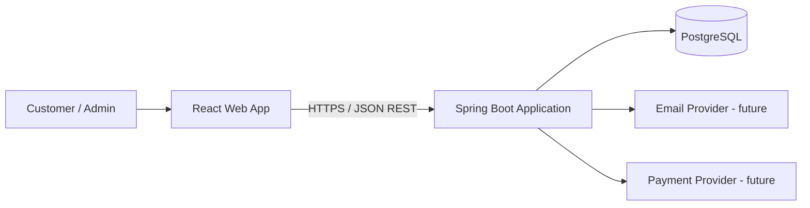

# Architecture Overview

## 1. Architectural style

The application starts as a **modular monolith**: one backend deployable, one relational database and one frontend deployable. Internally, the backend is divided into business capabilities with explicit boundaries.

A modular monolith is not a collection of microservices running in one process. Modules share a process and deployment, but do not share internal implementation details.

## 2. High-level context



## 3. Backend module boundaries

| Module | Owns | Public capabilities |
|---|---|---|
| identity | users, roles, credentials | register, authenticate, manage access |
| catalogue | books, authors, categories | browse, search, manage book metadata |
| inventory | stock and stock movements | availability, reserve, release, adjust |
| cart | carts and cart items | add, update, remove, view cart |
| orders | orders and order items | place, view and cancel orders |
| payments | payment attempts and provider references | initiate, confirm, refund |
| reviews | customer reviews and ratings | submit, moderate and list reviews |
| notifications | notification delivery state | send order/account notifications |

### Dependency rules

1. `api` depends on `application`; it does not contain business rules.
2. `application` orchestrates use cases and depends on domain abstractions.
3. `domain` contains business concepts and rules; it must not depend on Spring, JPA or web frameworks.
4. `infrastructure` implements persistence and external-system adapters.
5. A module may call another module only through its published application interface or an explicitly defined event contract.
6. No module may query another module's repositories or write to another module's tables.
7. Avoid cyclic module dependencies. If two modules need each other, introduce a stable interface/event or revisit the boundary.

## 4. Internal module structure

Each module follows this pattern:

```text
catalogue/
  api/              # REST controllers and request/response DTOs
  application/      # use cases, commands, queries, ports
  domain/           # aggregates, value objects, domain rules
  infrastructure/  # JPA adapters, external adapters
```

Do not create empty classes just to fill every folder. Add implementation when a use case requires it.

## 5. Data ownership while using one database

The initial deployment uses one PostgreSQL database for operational simplicity. Logical ownership still applies:

- Catalogue owns books, authors and categories.
- Inventory owns stock records.
- Cart owns carts and cart items.
- Orders owns orders and order items.
- Payments owns payment records.
- Identity owns users and roles.

For this starter, the first Flyway migration creates the initial schema in one database. As modules mature, migrations should be split by module naming/ownership (for example `catalogue`, `orders`) and cross-module references should be minimised. A future service extraction gives each service its own database/schema and migration lifecycle.

## 6. Transactions and cross-module workflows

A use case contained within one module can use a local database transaction. Do not assume a future distributed workflow can use one ACID transaction across services.

For checkout, evolve toward:
- an order state machine (`PENDING`, `CONFIRMED`, `CANCELLED`);
- inventory reservation with expiry;
- payment provider interaction using idempotency keys;
- an outbox table for reliably publishing domain events;
- compensating actions (release inventory / cancel order) when a later step fails.

Do not call a payment provider while holding a long-running database transaction.

## 7. API conventions

- Prefix REST endpoints with `/api/v1`.
- Use resource nouns, HTTP methods and appropriate status codes.
- Validate incoming DTOs.
- Return consistent error responses (RFC 9457 Problem Details is a suitable target).
- Never expose persistence entities directly.
- Add pagination, filtering and sorting to collection endpoints.
- Document APIs with OpenAPI when feature endpoints are introduced.

## 8. Security baseline

The scaffold intentionally does not yet expose registration/login or payment operations. Before those features are implemented:
- use Spring Security;
- hash passwords with a modern adaptive password encoder (Argon2id or BCrypt);
- enforce server-side role/ownership checks;
- keep secrets in environment/secret management, never source control;
- use HTTPS in deployed environments;
- validate payment provider webhooks and make handlers idempotent;
- do not store raw card data.

## 9. Observability and quality

Add structured logs with correlation/request IDs, health/readiness probes, metrics and tracing as the application grows. Test at multiple levels:
- domain unit tests;
- application/use-case tests;
- repository integration tests against PostgreSQL (e.g. Testcontainers);
- API integration tests;
- Playwright end-to-end critical journeys.

## 10. Future extraction criteria

Extract a module only when there is a clear business or operational reason, such as independent scaling, separate release cadence, team ownership or fault isolation.

Extraction checklist:
1. Confirm module boundary and data ownership.
2. Replace in-process calls with versioned API/event contracts.
3. Move data ownership to the new service; avoid permanent shared database writes.
4. Use outbox/inbox and idempotent consumers for reliable messaging.
5. Add timeouts, retries with backoff, circuit breaking where justified.
6. Deploy and observe independently.
7. Remove the old in-process implementation after traffic and data migration are verified.
