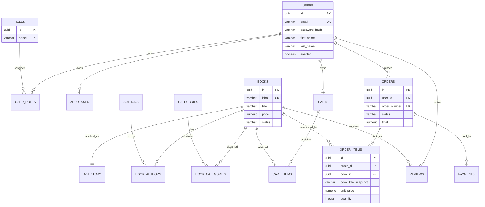

# Database Design

## Design principles

- PostgreSQL is the source of truth for transactional data.
- UUID primary keys make identifiers portable across future service boundaries.
- `NUMERIC(12,2)` is used for prices and totals; Java uses `BigDecimal`.
- Timestamps are stored as `TIMESTAMPTZ`.
- Order items preserve the purchased title and unit price as snapshots.
- Foreign keys and check constraints protect data integrity.
- Schema changes are versioned with Flyway.

## Entity relationship diagram

## Tables in the initial migration

| Table | Purpose |
|---|---|
| users, roles, user_roles | Identity and authorisation |
| addresses | Customer delivery addresses |
| authors, categories | Catalogue reference data |
| books, book_authors, book_categories | Book catalogue |
| inventory | Available and reserved stock |
| carts, cart_items | Active shopping carts |
| orders, order_items | Purchase history and price snapshots |
| payments | Payment attempts/provider references |
| reviews | Customer ratings and comments |

## Important implementation notes

- `books.price` is the current selling price. `order_items.unit_price` is the price agreed at purchase.
- `inventory.available_quantity` is constrained to be non-negative. A later reservation workflow should use atomic updates/locking to prevent overselling.
- A cart should be unique per active customer. Guest carts can be added later with a secure opaque token.
- Payment records store provider references and status, not card numbers or CVV.
- Reviews should be unique per user/book unless the product requirements explicitly allow multiple reviews.
- Soft deletion is not applied indiscriminately. Prefer explicit lifecycle/status fields where business history matters.
